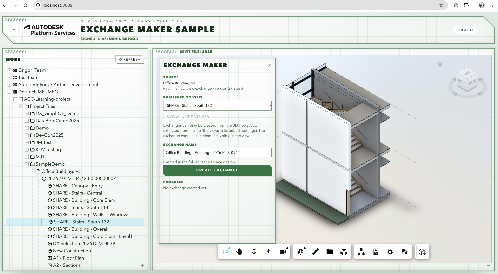
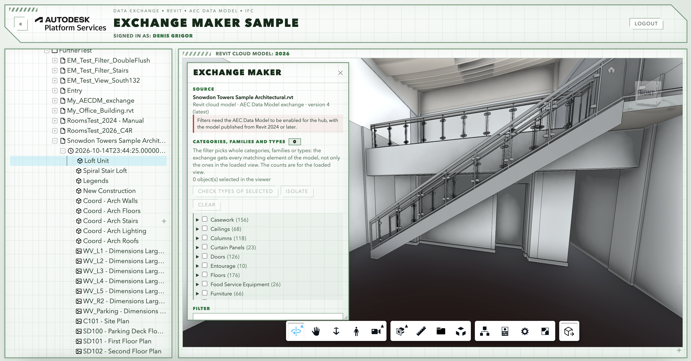
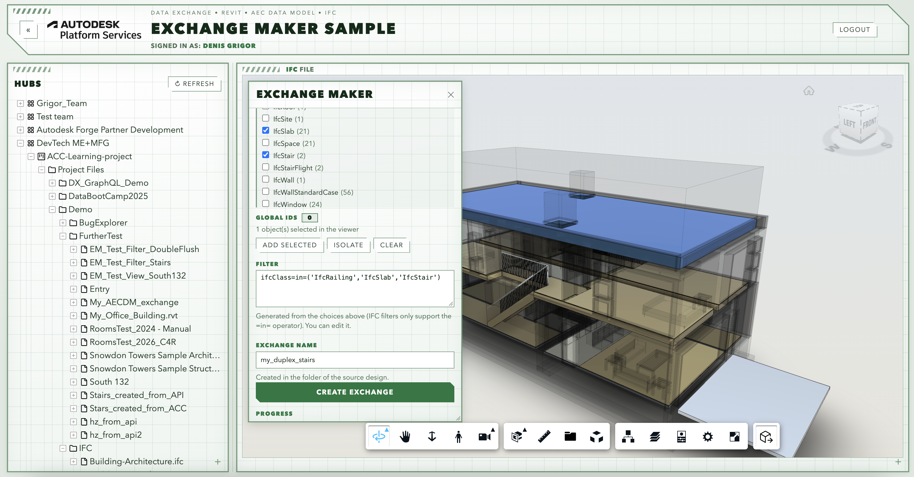

# APS Exchange Maker (.NET)

[](https://dotnet.microsoft.com/)
[](http://opensource.org/licenses/MIT)

## Description

This sample creates a [Data Exchange](https://aps.autodesk.com/data-exchange-api) from the design that is open in the Viewer, with the [Data Exchange GraphQL `createExchange` mutation API](https://aps.autodesk.com/en/docs/fdxgraph/v1/tutorials/mutations/exchanges_and_mutations/). 

This sample is based on the [Hubs Browser](https://github.com/autodesk-platform-services/aps-hubs-browser-dotnet) sample ([explained in this tutorial](https://get-started.aps.autodesk.com/tutorials/hubs-browser/)), extended with a Viewer extension that finds out what kind of design is open and shows the matching dialog:

| Design | Dialog | `createExchange` input |
|---|---|---|
| Revit file uploaded to ACC | pick one of the published 3D views | `viewName` ([tutorial](https://aps.autodesk.com/en/docs/fdxgraph/v1/tutorials/mutations/3d_view_based_exchange/)) |
| Revit cloud model (AEC Data Model) | check categories, families and types | `filter`, e.g. `(category=='Windows')` ([tutorial](https://aps.autodesk.com/en/docs/fdxgraph/v1/tutorials/mutations/aec_dm_exchange/)) |
| IFC file | check IFC classes, add GlobalIds of selected elements | `filter`, e.g. `ifcClass=in=('IfcDoor')` ([tutorial](https://aps.autodesk.com/en/docs/fdxgraph/v1/tutorials/mutations/IFC_exchange/)) |

Exchanges and other file types are reported as not supported. The exchange is created in the folder of the source design, and the tree shows it when it is done.

## Thumbnail

A Revit file: pick one of its published 3D views.



A Revit cloud model (AEC Data Model): check categories, families and types.



An IFC file: check IFC classes, or add the elements selected in the Viewer.



## Dependencies

- **[.NET 8 SDK](https://dotnet.microsoft.com/download)**
- **APS account**: [create an app](https://aps.autodesk.com/myapps) with the callback URL `http://localhost:8082/api/auth/callback`, with access to the Data Management, Model Derivative and Data Exchange APIs.
- The app's client ID added as a **custom integration** in your ACC account ([instructions](https://get-started.aps.autodesk.com/#provision-access-in-other-products)).
- For Revit cloud models: the [AEC Data Model enabled](https://aps.autodesk.com/en/docs/aecdatamodel/v1/developers_guide/onboarding/) for the hub, with models published from Revit 2024 or later.
- The used client id needs to be provisioned as [described here](https://get-started.aps.autodesk.com/#provision-access-in-other-products)

## Running locally

The Viewer and the Data Exchange API need a 3-legged token, so you sign in through the browser. The tokens are kept in cookies and refreshed automatically.

### 1. Set the APS credentials

```bash
export APS_CLIENT_ID="your client ID"
export APS_CLIENT_SECRET="your client secret"
export APS_CALLBACK_URL="http://localhost:8080/api/auth/callback"
```

### 2. Run the app

```bash
cd WebApp
dotnet run
```

### 3. Open the app

Open [http://localhost:8080](http://localhost:8080), log in, and pick a design version in the tree. Open the **Exchange Maker** panel with its toolbar button, make your choices, and click **Create exchange**. When the exchange is created, it shows up in the tree next to the source design and can be opened in the Viewer (use **Refresh** to reload the tree).

The default port is 8080, but you can change it in `WebApp/Properties/launchSettings.json`and it is important to match the port used in the callback url.

## Known issues

- **Exchange names** must be unique in the folder.
- **Exchanges are always created from the latest version of the source file.** The panel warns when an older version is open.
- **Revit files: only published views.** ACC only extracts the views listed in the file's publish settings, and Data Exchange can only use extracted views. The [Exchange Creator](https://github.com/autodesk-platform-services/aps-dx-graphql-exchange-creator-net) sample creates an exchange from any set of elements.
- **AEC Data Model filters pick whole categories, families or types**, never individual elements.
- **ACC previews a filter-based exchange with the views of its source model.** The exchange's data is still filtered; the panel shows what the exchange contains (counts per category) and can isolate its elements in the Viewer.
- **IFC properties** are named differently depending on how the IFC file was translated. If no IFC class is found, type the filter by hand.


## Further reading

- [APS Data Exchange GraphQL tutorial](https://autodesk-platform-services.github.io/aps-dx-graphql-tutorial/)  
- [Exchange Creator](https://github.com/autodesk-platform-services/aps-dx-graphql-exchange-creator-net): creates an exchange from a selection of elements
- [Exchange Monitor](https://github.com/autodesk-platform-services/aps-dx-graphql-exchange-monitor-net): watches a Revit file with a webhook and shows what changed in an exchange


## License

This sample is licensed under the terms of the [MIT License](LICENSE).
